<!-- Ujjal Kumar Roy — Senior Full-Stack Software Engineer · Next.js · React · TypeScript · Node.js · NestJS · Dhaka, Bangladesh · Open to remote & onsite -->

<picture><source media="(prefers-color-scheme: dark)" srcset="assets/hero-dark.svg">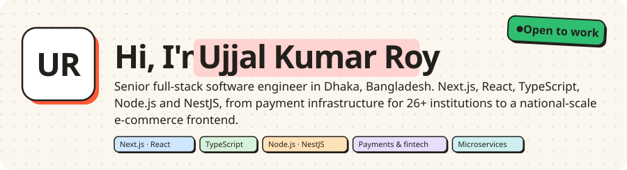</picture>

<a href="https://www.linkedin.com/in/ujjalkumarroy/"><picture><source media="(prefers-color-scheme: dark)" srcset="assets/badge-linkedin-dark.svg"></picture></a>
<a href="mailto:ujjalroy7862@gmail.com?subject=Opportunity%20for%20Ujjal%20Kumar%20Roy"><picture><source media="(prefers-color-scheme: dark)" srcset="assets/badge-mail-dark.svg"></picture></a>
<a href="https://my-portfolio-c465b.web.app/"><picture><source media="(prefers-color-scheme: dark)" srcset="assets/badge-globe-dark.svg"></picture></a>
<a href="https://leetcode.com/ujjalroy7862"><picture><source media="(prefers-color-scheme: dark)" srcset="assets/badge-code-dark.svg"></picture></a>
<a href="https://stackoverflow.com/users/13442641/ujjal-roy"><picture><source media="(prefers-color-scheme: dark)" srcset="assets/badge-stack-dark.svg"></picture></a>

<picture><source media="(prefers-color-scheme: dark)" srcset="assets/label-about-dark.svg"></picture>

<picture><source media="(prefers-color-scheme: dark)" srcset="assets/about-dark.svg"></picture>

<picture><source media="(prefers-color-scheme: dark)" srcset="assets/numbers-dark.svg">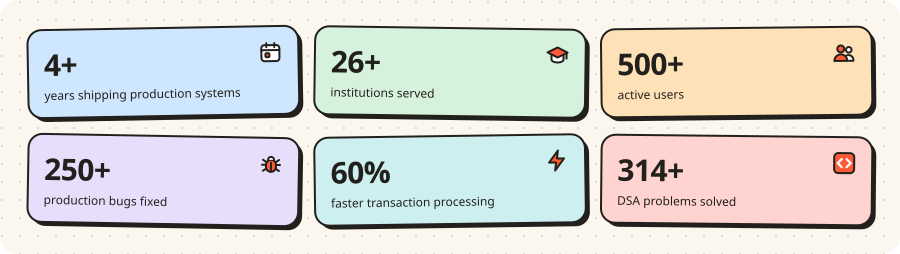</picture>

<picture><source media="(prefers-color-scheme: dark)" srcset="assets/label-recruiter-dark.svg"></picture>

<picture><source media="(prefers-color-scheme: dark)" srcset="assets/recruiter-dark.svg"></picture>

<picture><source media="(prefers-color-scheme: dark)" srcset="assets/label-bring-dark.svg"></picture>

<picture><source media="(prefers-color-scheme: dark)" srcset="assets/bring-0-dark.svg">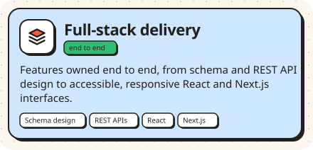</picture>
<picture><source media="(prefers-color-scheme: dark)" srcset="assets/bring-1-dark.svg">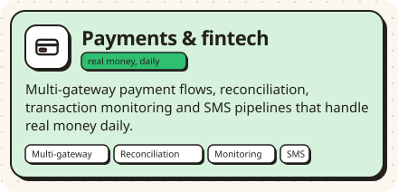</picture>
<picture><source media="(prefers-color-scheme: dark)" srcset="assets/bring-2-dark.svg">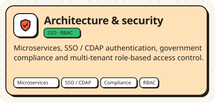</picture>
<picture><source media="(prefers-color-scheme: dark)" srcset="assets/bring-3-dark.svg">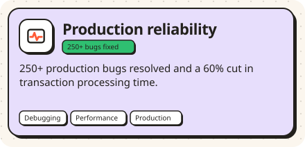</picture>
<picture><source media="(prefers-color-scheme: dark)" srcset="assets/bring-4-dark.svg">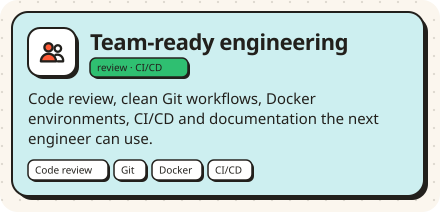</picture>

<picture><source media="(prefers-color-scheme: dark)" srcset="assets/label-stack-dark.svg"></picture>

<picture><source media="(prefers-color-scheme: dark)" srcset="assets/stack-dark.svg">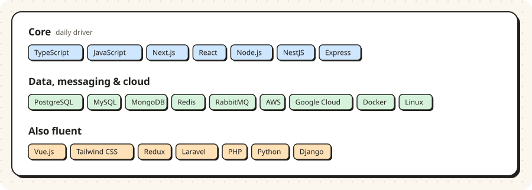</picture>

<b>Full skills list</b>

 

| Layer | Tools & Technologies |
|:---|:---|
| **Languages** | TypeScript · JavaScript (ES6+) · PHP · Python · SQL |
| **Frontend** | Next.js 15 · React · Vue.js · Redux · TailwindCSS · Shadcn UI · Figma to code |
| **Backend** | Node.js · NestJS · Express · Laravel 10 · Django · REST API design · Microservices |
| **Data & messaging** | PostgreSQL · MySQL · MongoDB · Redis · RabbitMQ |
| **DevOps & Cloud** | AWS · Google Cloud Platform (GCP) · Docker · Linux · Nginx · CI/CD · Git & GitHub |
| **Integrations** | Ekpay payment gateway · Teletalk SMS gateway · SSO / CDAP · third-party REST APIs |
| **Practices** | System design · Role-based access control · Code review · Agile delivery · SEO optimisation |

<picture><source media="(prefers-color-scheme: dark)" srcset="assets/label-experience-dark.svg"></picture>

<picture><source media="(prefers-color-scheme: dark)" srcset="assets/experience-dark.svg"></picture>

<picture><source media="(prefers-color-scheme: dark)" srcset="assets/label-work-dark.svg"></picture>

<a href="https://judipay.gov.bd"><picture><source media="(prefers-color-scheme: dark)" srcset="assets/work-0-dark.svg">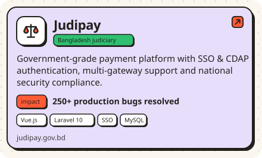</picture></a>
<a href="https://polytechnic.aalo.xyz"><picture><source media="(prefers-color-scheme: dark)" srcset="assets/work-1-dark.svg">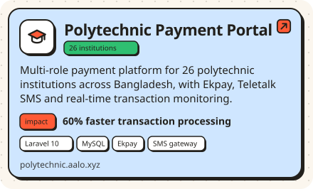</picture></a>
<a href="https://www.elitestakescap.com"><picture><source media="(prefers-color-scheme: dark)" srcset="assets/work-2-dark.svg">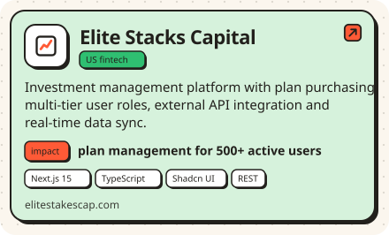</picture></a>
<a href="https://dev-hrpay.softbd.xyz"><picture><source media="(prefers-color-scheme: dark)" srcset="assets/work-3-dark.svg">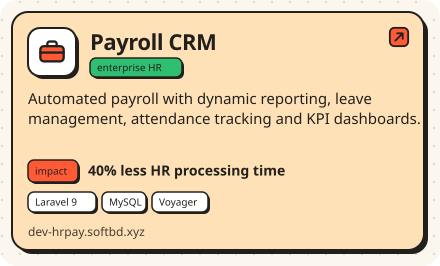</picture></a>

<a href="https://github.com/ujjal-kumar-roy?tab=repositories"><b>Browse all my repositories →</b></a>

<picture><source media="(prefers-color-scheme: dark)" srcset="assets/label-recognition-dark.svg"></picture>

<picture><source media="(prefers-color-scheme: dark)" srcset="assets/recognition-dark.svg">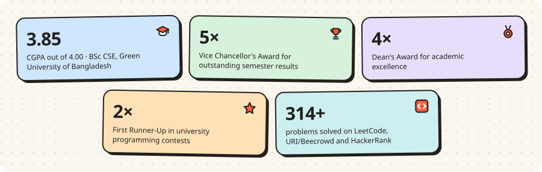</picture>

<picture><source media="(prefers-color-scheme: dark)" srcset="assets/label-activity-dark.svg"></picture>

<picture><source media="(prefers-color-scheme: dark)" srcset="assets/stats-dark.svg">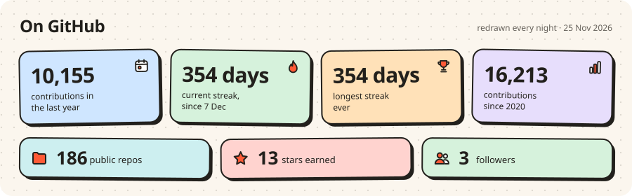</picture>

<picture><source media="(prefers-color-scheme: dark)" srcset="assets/graph-6m-dark.svg">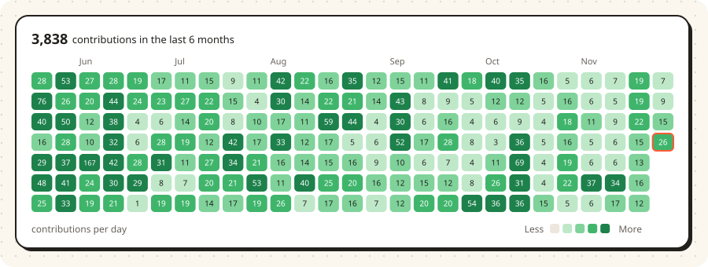</picture>

<b>Last 12 months</b>

<picture><source media="(prefers-color-scheme: dark)" srcset="assets/graph-12m-dark.svg">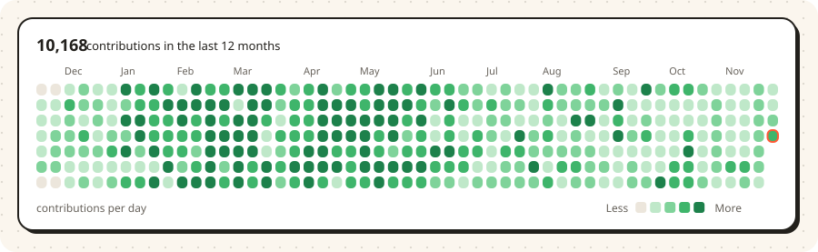</picture>

<picture><source media="(prefers-color-scheme: dark)" srcset="assets/line-30d-dark.svg">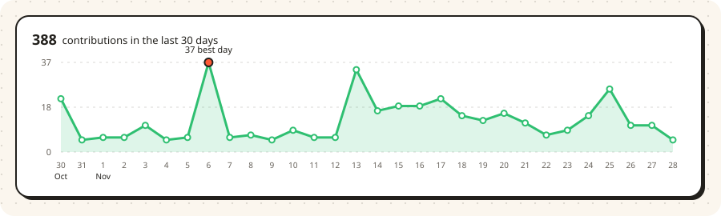</picture>

<picture><source media="(prefers-color-scheme: dark)" srcset="assets/label-contact-dark.svg"></picture>

<a href="mailto:ujjalroy7862@gmail.com?subject=Opportunity%20for%20Ujjal%20Kumar%20Roy"><picture><source media="(prefers-color-scheme: dark)" srcset="assets/contact-dark.svg">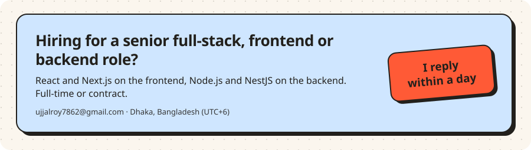</picture></a>

<a href="mailto:ujjalroy7862@gmail.com?subject=Opportunity%20for%20Ujjal%20Kumar%20Roy"><picture><source media="(prefers-color-scheme: dark)" srcset="assets/badge-mail-dark.svg"></picture></a>
<a href="https://www.linkedin.com/in/ujjalkumarroy/"><picture><source media="(prefers-color-scheme: dark)" srcset="assets/badge-linkedin-dark.svg"></picture></a>
<a href="https://my-portfolio-c465b.web.app/"><picture><source media="(prefers-color-scheme: dark)" srcset="assets/badge-globe-dark.svg"></picture></a>

<i>Ujjal Kumar Roy — senior full-stack developer in Dhaka, Bangladesh · Next.js developer · React developer · TypeScript · Node.js and NestJS backend engineer · microservices · Redis · RabbitMQ · AWS · payment gateway integration · e-commerce, fintech and government web applications · available for remote work worldwide.</i>

